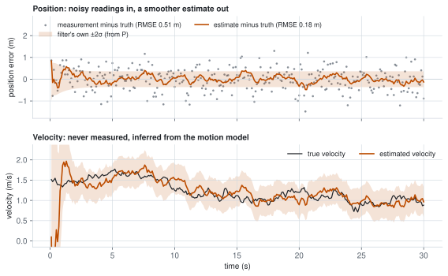
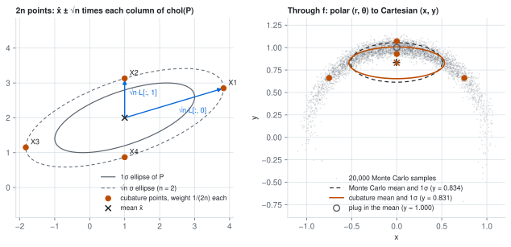
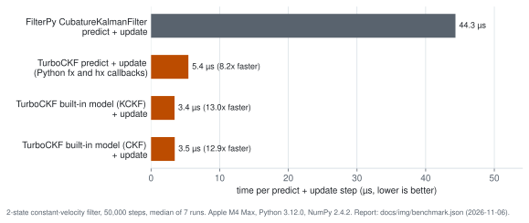

# turbo-ckf

[](https://pypi.org/project/turbo-ckf/)
[](https://pypi.org/project/turbo-ckf/)
[](https://github.com/mokhld/turbo-ckf/actions/workflows/ci.yml)
[](#license)

`turbo-ckf` is a Rust-backed Cubature Kalman Filter package for high-throughput prediction/update loops. Implemented here purely as an experiment after reading the paper.

It estimates a state you cannot observe directly (a position and velocity, an
orientation, a clock offset) from noisy measurements. You write the motion
model `fx` and the measurement model `hx` as vectorized NumPy functions, set
`x`, `P`, `Q` and `R` as in FilterPy, and call `predict()` and `update(z)`. The
maths of every step runs in Rust.

<picture>
  <source media="(prefers-color-scheme: dark)" srcset="https://raw.githubusercontent.com/mokhld/turbo-ckf/main/docs/img/tracking-dark.svg">
  
</picture>

A constant-velocity tracker on 300 position readings with 0.5 m noise. The
position error drops from 0.51 m (raw readings) to 0.18 m, and the velocity,
which is never measured, is recovered from the motion model. The shaded band is
the filter's own ±2σ from `P`. Drawn by `scripts/readme_figures.py`.

## How it works

A Kalman filter keeps a Gaussian belief about the state: a mean `x` and a
covariance `P`. Each step it predicts (pushes the belief through `fx` and adds
the process noise `Q`) and then updates (compares the measurement with what
`hx` expects and moves toward it, weighted by how much it trusts each side).
For linear models this is exact. For a nonlinear `fx` or `hx` the filter needs
the mean and covariance of a Gaussian after it passes through a nonlinear
function, which has no closed form.

The cubature Kalman filter (Arasaratnam and Haykin, 2009) approximates them
with 2n sample points, where n is the state size: the mean plus and minus √n
times each column of the Cholesky factor of `P`, all with weight 1/(2n). Push
the points through the model and take their weighted mean and covariance. The
rule is exact for polynomials up to degree three, has no tuning parameters
(the UKF has alpha, beta and kappa), and never uses negative weights.

<picture>
  <source media="(prefers-color-scheme: dark)" srcset="https://raw.githubusercontent.com/mokhld/turbo-ckf/main/docs/img/cubature-dark.svg">
  
</picture>

Left: the four points for a 2-D state, captured from inside `fx`, so they are
exactly what the Rust backend computes. Right: the same rule applied to a
polar-to-Cartesian conversion with a wide angle uncertainty. The cubature mean
(y = 0.831) lands close to the mean of 20,000 Monte Carlo samples (y = 0.834).
Plugging the mean straight into the function, which is how an EKF predicts the
mean, gives y = 1.0.

## What This Package Optimizes

- Fast prediction with built-in linear models:
  - `predict_standard_model(...)`
  - `predict_standard_model_ckf(...)`
  - `predict_linear_model(F)`
  - `predict_linear_model_ckf(F)`
- Fast AHRS update path:
  - `update_paper_ahrs(...)`

`predict(...)` and `update(...)` also run through Rust, but callback cost in Python can dominate if your models are heavy.

## Square-Root Variant

`TurboSRCKF` is a separate estimator that propagates the lower-triangular Cholesky factor of `P` directly. Predict and update produce the next factor through QR decompositions and rank-1 Cholesky downdates, so in normal operation the loop never re-factors `P` and never adds the diagonal jitter that `TurboCKF` reports in `jitter_count`. The exception is a downdate that fails numerically: the update then rebuilds `P`, re-factors it and increments `downdate_fallback_count` (and `jitter_count` if the re-factor needed jitter). Use it when `P` becomes ill-conditioned (e.g., long predict chains with tiny `Q`/`R`, or rank-deficient seed covariances). Mirrors `predict(...)` + `update(...)`; for closed-form linear predicts or the AHRS update use `TurboCKF`.

```python
from turbo_ckf import TurboSRCKF
kf = TurboSRCKF(dim_x=4, dim_z=2, dt=0.1, hx=hx_vectorized, fx=fx_vectorized)
kf.predict()
kf.update(z)
# kf.chol_P is the lower-triangular factor; kf.P = chol_P @ chol_P.T
```

## Callback Contract

Custom `fx` and `hx` must be vectorized:

- Input shape is `(2 * dim_x, dim_x)`.
- `fx` output shape must be `(2 * dim_x, dim_x)`.
- `hx` output shape must be `(2 * dim_x, dim_z)`.

If you pass pointwise callbacks, `TurboCKF` raises immediately.

Callbacks run while Rust holds the filter for the whole step, so they must not
use the filter that is calling them. Reading an attribute such as `kf.P_prior`
inside `fx` raises `RuntimeError: Already mutably borrowed`. Pass anything the
model needs through `fx_args` and `hx_args`.

## Install

```bash
pip install turbo-ckf
```

Prebuilt wheels (one abi3 wheel per platform, CPython 3.9 or newer; CI tests
3.9 to 3.13) are published for three platforms only:

- Linux x86_64 (manylinux2014, glibc 2.17 or newer)
- macOS arm64 (Apple silicon, macOS 11 or newer)
- Windows x64

Everywhere else, including Linux aarch64 (for example Raspberry Pi), musl Linux
(Alpine) and Intel Macs, `pip` builds from the sdist. That needs a Rust
toolchain on `PATH` (install one from https://rustup.rs).

## Install from source (development)

From `turbo-ckf/`:

```bash
bash turbo_ckf/setup_env.sh
```

## Usage

```python
from turbo_ckf import TurboCKF

kf = TurboCKF(dim_x=2, dim_z=1, dt=0.1, hx=hx_vectorized, fx=fx_vectorized)
kf.predict_standard_model("constant_velocity")
kf.update(z)
```

The built-in models, `"constant_velocity"` and `"constant_acceleration"`, need
to know how the state vector is ordered. The default, `layout="blocked"`, is all
positions, then all velocities, then all accelerations: `[x, y, vx, vy]` or
`[x, y, vx, vy, ax, ay]`. FilterPy code usually orders the state per axis,
`[x, vx, y, vy]` or `[x, vx, ax, y, vy, ay]`; pass `layout="interleaved"` for
that. `predict_standard_model_ckf` takes the same argument. The layout cannot
be inferred from the state, so a mismatch gives wrong predictions without an
error. With `dim_x=2` (or 3 for constant acceleration) the two layouts are the
same.

```python
# FilterPy-style 2-D state [x, vx, y, vy]
kf = TurboCKF(dim_x=4, dim_z=2, dt=0.1, hx=hx_vectorized, fx=fx_vectorized)
kf.predict_standard_model("constant_velocity", layout="interleaved")
```

State assignment is forgiving about spelling: `x` accepts lists, integer
arrays, and column vectors; `P`, `Q`, `R` accept scalars (`kf.R = 0.25` means
`0.25 * I`), 1-D diagonals (`kf.Q = [1e-3, 1e-2]`), or full matrices. Wrong
sizes and non-finite values raise at assignment time with the attribute named
in the error. Changing `kf.dt` after construction takes effect on the next
predict, including the standard/linear-model paths.

A NaN or inf measurement raises instead of corrupting the state. For a missed
measurement pass `z=None`, which runs the predict-only step and clears the
innovation diagnostics. The same applies to `batch_filter`, which does not skip
missing measurements yet (use `run(..., nan_means_missing=True)` for sequences
with dropouts), and to callback outputs: an `fx` or `hx` that returns NaN or
inf raises a `ValueError` naming it, and the state is left unchanged. In
`batch_parallel_step`, a filter whose own `x`, `P` or `z` is non-finite gets
status 3 and is skipped while the rest of the bank updates.

### Filter state lives in Rust

The Rust backend holds `x`, `P`, `Q`, `R` and every diagnostic (`K`, `y`, `S`,
`x_prior`, `P_post`, `log_likelihood`, `nis`, the jitter counters). An
attribute is copied into NumPy only when you read it, and that copy is reused
until the next `predict`/`update`, so a loop that reads nothing pays nothing
for state sync.

In-place edits work as in FilterPy. The array returned by `kf.x`, `kf.P`,
`kf.Q` or `kf.R` is the filter's current value, and writing into it
(`kf.x[0] = 1.0`, `kf.P[2:, 2:] *= 1000`) takes effect on the next call. Once a
`predict`/`update` or an assignment replaces the value, the array you held
becomes a read-only snapshot, so a late write raises `ValueError` instead of
being dropped silently, and `history.append(kf.x)` needs no `.copy()`.
Assignment copies your array into the filter. Output arrays such as `kf.K` are
snapshots that do not feed back into the filter, and `TurboSRCKF`'s `chol_P`,
`chol_Q`, `chol_R` are read-only. Reading never changes results; in
`TurboSRCKF` it never re-factors `P` either.

`copy()`, `to_dict()`/`from_dict()` and `pickle` keep the diagnostic counters,
and `reset()` zeroes them. Pickling stores `fx` and `hx` by reference, so use
module-level functions (a lambda makes `pickle` raise). `TurboSRCKF.to_dict()`
stores `chol_P`, so restoring does not re-factor `P`.

Per step, 4-state / 2-measurement constant-velocity model with a vectorized
`hx`, Apple M4 Max, median of 7 runs:

| Loop | State copied every call | State in Rust |
| --- | --- | --- |
| `predict_standard_model` + `update` | 12.6 us | 4.1 us |
| same, reading `kf.x` and `kf.P` each step | 12.5 us | 4.7 us |
| `predict` + `update` with `fx`/`hx` callbacks | 15.7 us | 6.8 us |
| `TurboSRCKF` `predict` + `update` | 18.9 us | 6.6 us |
| `run()` over 10,000 steps (total) | 182 ms | 51 ms |

### Filtering a whole sequence

`run(...)` wraps the predict/update loop, stacks the per-step outputs, and
handles measurement dropouts:

```python
result = kf.run(zs)                # zs: (N, dim_z), or (N,) when dim_z == 1
result.xs, result.Ps               # posterior means / covariances, stacked
result.log_likelihoods, result.nis # per-step diagnostics

# Missed measurements: None entries (or all-NaN rows with
# nan_means_missing=True) skip the update for that step.
kf.run([z0, None, z2])
kf.run(zs, nan_means_missing=True)

# Per-step time steps and measurement noise:
kf.run(zs, dts=dt_array, Rs=r_stack)
```

`run` is available on both `TurboCKF` and `TurboSRCKF`. For linear models
prefer the static `TurboCKF.batch_filter`, which runs the whole loop inside
Rust in a single crossing.

AHRS path:

```python
kf.predict_linear_model(Fk)
kf.update_paper_ahrs(z6, sigma_acc2=1e-2, sigma_mag2=1e-2)
```

`z6` is `[ax, ay, az, mx, my, mz]` in any units, for example raw m/s^2 and uT.
The paper's observation model predicts unit vectors, so the update normalizes
the accelerometer and magnetometer 3-vectors to unit length before using them
(a zero or non-finite norm raises `ValueError`). `sigma_acc2` and `sigma_mag2`
are therefore variances of the unit-vector components, not of the raw readings.
The filter needs `dim_x=4` (quaternion) and `dim_z=6`, and the update overwrites
`R` with `diag(sigma_acc2, sigma_acc2, sigma_acc2, sigma_mag2, sigma_mag2, sigma_mag2)`.

## Differences from FilterPy

The API copies FilterPy's attribute names, and the linear paths match FilterPy
to floating-point precision (`batch_filter` and `rts_smooth` are tested against
it). Two differences are deliberate:

- `TurboCKF.update` draws a fresh set of cubature points from the predicted `x`
  and `P`, as in Arasaratnam and Haykin's algorithm. FilterPy's
  `CubatureKalmanFilter.update` reuses the points it propagated in `predict`,
  and their spread leaves out `Q`, because `Q` is added to `P` after
  propagation. With `Q = 0` the two filters agree to about 1e-12. With `Q > 0`
  they differ: in the 2-state test in `turbo_ckf_tests/test_math.py`,
  TurboCKF's posterior position variance is smaller than FilterPy's by exactly
  the `Q` used (1e-3), and the state differs slightly whenever the innovation
  is not zero.
- The built-in motion models default to the blocked state layout
  `[x, y, vx, vy]`; FilterPy code usually uses `[x, vx, y, vy]`. See Usage.

## Limitations

- Angle measurements need care. The update averages the predicted
  measurements and forms the residual `z - z_pred` with plain arithmetic, and
  there is no hook for a custom mean or residual function (FilterPy has
  `z_mean_fn` and `residual_z`). A bearing near ±π breaks the update: a
  prediction of 3.137 rad and a reading of -3.141 rad give a residual of -6.28
  instead of about 0. Keep angles away from the seam, or measure
  `(cos θ, sin θ)` instead of θ.
- Callbacks cannot use the filter that is calling them (see Callback Contract).
- Prebuilt wheels cover three platforms; elsewhere `pip` needs a Rust
  toolchain (see Install).

## Benchmarks

### Paper-Reported Targets (Yamagishi and Jing, arXiv:2602.12283)

These are the KCKF-vs-CKF results reported in the paper:

- MacBook Pro 2021 (M1 Pro): KCKF `0.110 ms` vs CKF `0.135 ms` (`18.79%` lower time, about `1.23x` faster).
- Raspberry Pi 4 Model B: KCKF `1.28 ms` vs CKF `1.51 ms` (`15.15%` lower time, about `1.18x` faster).

### Local Results In This Repo

Measured on **November 6, 2026** (v0.9.0) on Apple M4 Max, Python 3.12.0,
NumPy 2.4.2, FilterPy 1.4.5.

From:

```bash
.venv-turbo-ckf/bin/python turbo_ckf_tests/verify_before_after.py --steps 50000 --repeats 7 --warmup 1 --parity-steps 500 --output docs/img/benchmark.json
```

<picture>
  <source media="(prefers-color-scheme: dark)" srcset="https://raw.githubusercontent.com/mokhld/turbo-ckf/main/docs/img/benchmark-dark.svg">
  
</picture>

Median runtime per 50k predict+update steps of a 2-state constant-velocity
filter:

| Loop | Total | Per step | vs FilterPy |
| --- | --- | --- | --- |
| FilterPy `CubatureKalmanFilter` (`filterpy_predict_update`) | 2.217 s | 44.3 us | baseline |
| TurboCKF callback path (`turbo_callback_predict_update`) | 0.272 s | 5.4 us | 8.2x |
| TurboCKF standard model KCKF (`turbo_standard_model_predict_update`) | 0.171 s | 3.4 us | 13.0x |
| TurboCKF standard model CKF (`turbo_standard_model_ckf_predict_update`) | 0.173 s | 3.5 us | 12.9x |

The full report, with every sample, is `docs/img/benchmark.json`;
`scripts/readme_figures.py` draws the chart from it.

From:

```bash
.venv-turbo-ckf/bin/python turbo_ckf_tests/benchmark_paper.py
```

KCKF against CKF, range over five runs:

- Prediction only, backend: `1.24x` to `1.31x`
- Full step, backend: `0.96x` to `1.05x`
- Full step, through the Python wrapper: `0.93x` to `1.09x`

Interpretation:

- Most of the speed comes from running the filter in Rust instead of
  pure-Python FilterPy loops (`8.2x` to `13.0x` here). The February 2026 run
  measured `3.6x` to `4.4x`; v0.9.0 keeps the filter state in Rust, which
  removed most of the per-call copying.
- The paper's simplified prediction (KCKF) is about `1.3x` faster than the
  standard CKF prediction on its own. Over a full predict+update step the
  difference is within run-to-run noise on this machine.

## Research Basis

- This repo is an implementation of the KCKF AHRS equations described in:
  - Yamagishi, S. and Jing, L., "A Lightweight Cubature Kalman Filter for Attitude and Heading Reference Systems Using Simplified Prediction Equations", IEEE Access, vol. 14, pp. 73686-73697, 2026, doi:10.1109/ACCESS.2026.3686031. Preprint: arXiv:2602.12283, https://arxiv.org/abs/2602.12283.
- Credit for the method belongs to the paper authors.

## License

Dual-licensed under either:
- MIT (`LICENSE-MIT`)
- Apache-2.0 (`LICENSE-APACHE`)
